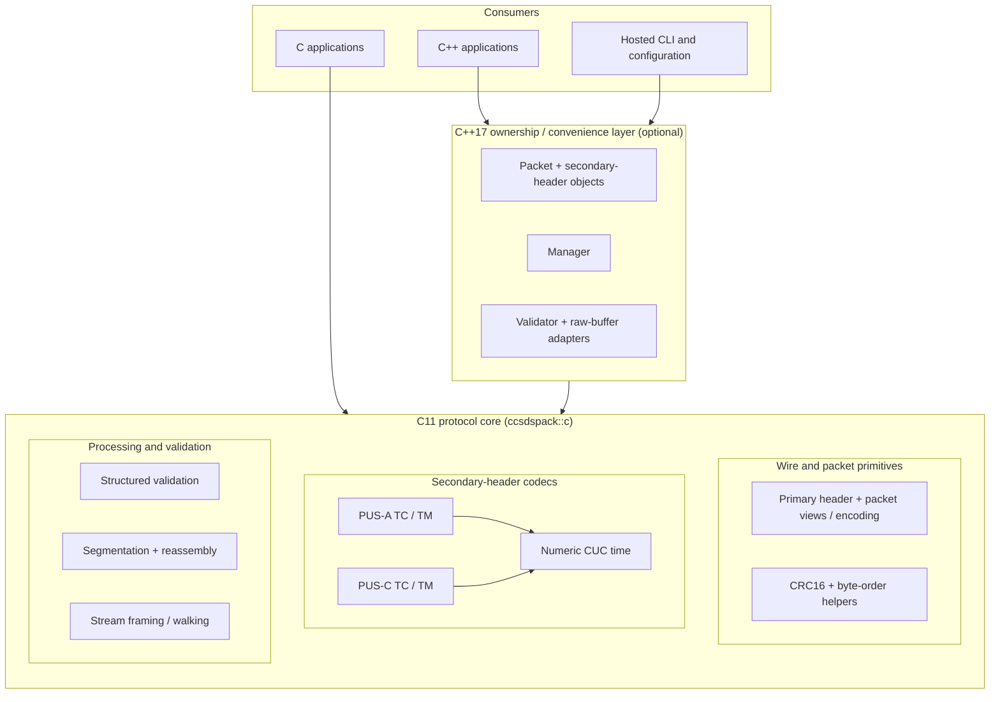
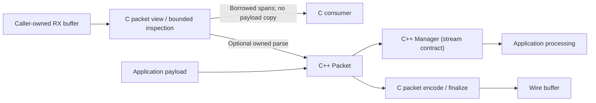
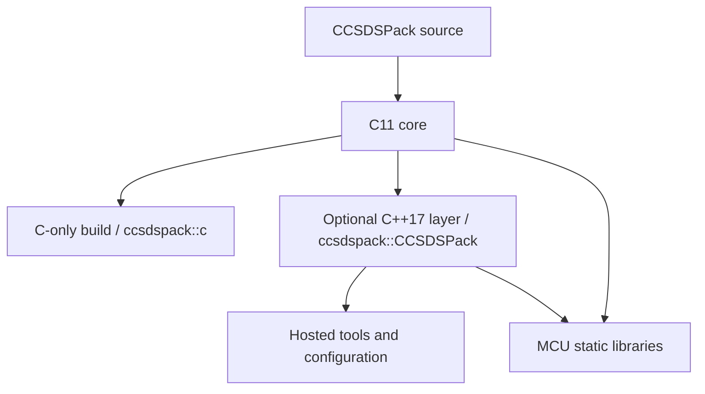

# CCSDSPack architecture

[Documentation index](README.md) | [Main README](../README.md) | [Packet processing flow](FLOW.md)

CCSDSPack v2.1 separates **protocol mechanics** in an authoritative C11 core from the existing **C++17 ownership/convenience layer**. The C core can be used independently; the C++ layer is optional at build time. The diagrams describe responsibilities and dependencies, not one-to-one source files or an exhaustive function call graph.

## Component architecture

### Responsibilities

| Layer | Responsibility | Availability |
| --- | --- | --- |
| C11 core | Caller-owned buffers/views; primary-header and packet encoding/inspection; CRC16 and byte order; PUS-A/PUS-C TC/TM codecs; basic numeric CUC; validation; segmentation/reassembly; stream primitives | Native hosted and MCU, including C-only builds |
| C++17 layer | Owned `Packet` / `Manager` workflows, concrete secondary-header objects, typed parsing, convenience APIs and `Validator` | Enabled by `CCSDSPACK_BUILD_CPP=ON` |
| Host integrations | Configuration loading, encoder/decoder/validator CLI, installed-package consumers | Hosted builds; excluded by `CCSDSPACK_BUILD_MCU=ON` |

## Ownership and processing boundaries

The C view is non-owning: buffers must remain valid while spans are used. C++ `Packet` and `Manager` own application-level state and may allocate. The C++ raw-buffer path avoids an intermediate full-packet transport bridge copy but still performs any copying required for ownership.

### PUS and packet policy

- Concrete C++ PUS identities are `ccsds::pus::rev_a::{TcHeader,TmHeader}` and `ccsds::pus::rev_c::{TcHeader,TmHeader}`. There is **no PUS-B implementation**.
- PUS revision and TC/TM direction belong to the concrete secondary-header type. Mission tailoring selects documented optional header fields.
- Packet error control is independent of PUS: `PacketErrorControlMode::CRC16` or `None` is configured at the Packet level.
- The CUC implementation handles a documented basic numeric subset, not calendar/UTC conversion or time correlation.
- Complete PUS services, transfer frames, COP-1, CFDP and routing are outside scope.

## Build profiles

`CCSDSPACK_BUILD_CPP=OFF` allows a C-only build without a C++ compiler. `CCSDSPACK_BUILD_MCU=ON` excludes host-only tooling; the optional C++ layer may still be built for the MCU target. Neither the complete library nor its C++ ownership API should be described as universally heap-free.

See [raw-buffer interfaces](RAW_BUFFERS.md), [PUS tailoring](MISSION_TAILORING.md), [structured validation](VALIDATION.md), [cross-builds](CROSSBUILD.md) and [compliance scope](PUS_CUC_COMPLIANCE.md).
